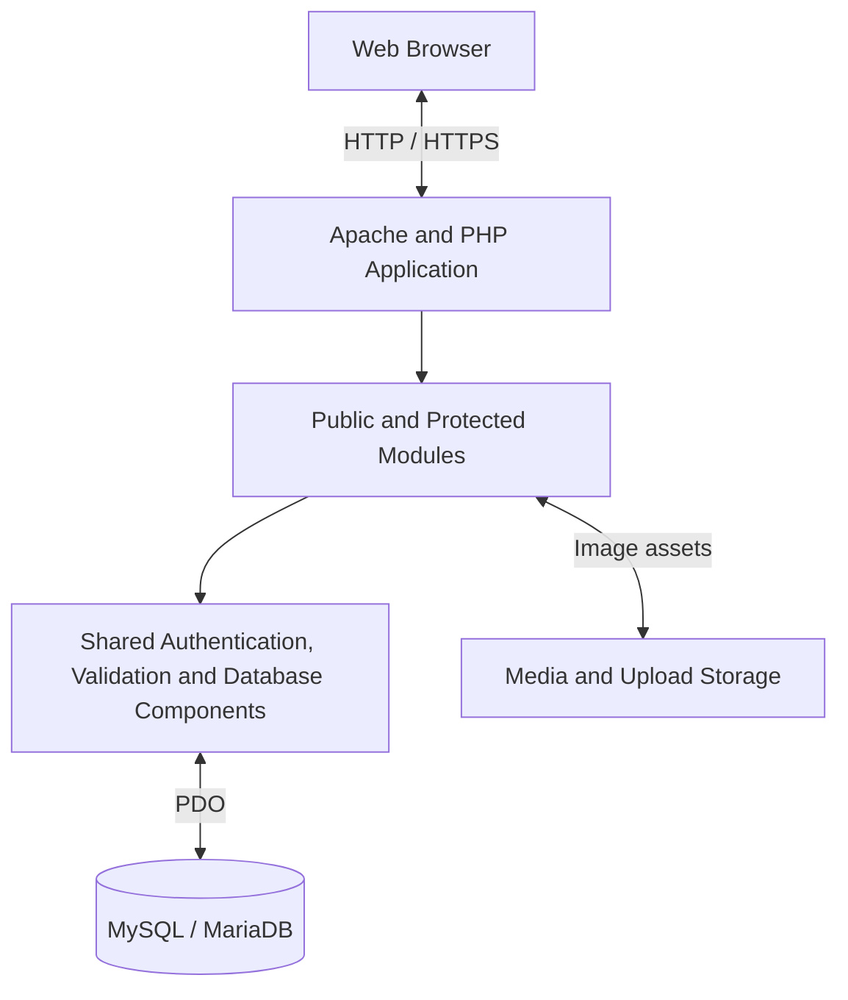

# NSBM SportsHub

**Sports Club Management System | NSBM Green University**

## Project Overview

NSBM SportsHub is a web-based sports management system that centralizes university sports administration and student participation. It provides a unified platform for managing sports clubs, tournaments, match fixtures, training sessions, facility reservations and sports news.

The system combines a responsive public portal with authenticated student services, club-specific staff functions and administrative management tools.

## Live Application

| Resource | URL |
| --- | --- |
| Live website | [nsbmsportshub.rf.gd](https://nsbmsportshub.rf.gd/) |
| Source repository | [GitHub](https://github.com/chamaracreates/nsbm-sporthub) |

Public sports information is available without authentication. Student services and administrative operations require an authorized account.

## Key Features

| Module | Functionality |
| --- | --- |
| Sports Clubs | Club profiles, membership applications, staff assignments, captain and vice-captain management |
| Tournaments | Competition administration, student registration and re-registration, team formation and roster management |
| Fixtures and Results | Standalone and tournament match scheduling, student registration and review, score recording, results and standings |
| Training | Session scheduling, venue allocation and attendance management |
| Facility Bookings | Facility information, reservation requests, availability validation and administrative review |
| Sports News | Club news publishing, image management and news feeds |
| Student Accounts | Registration, profile management, password changes and participation history |
| Administration and Reporting | Centralized management, operational statistics, filtered reports and CSV exports |

The public interface also includes global search, responsive navigation and light and dark themes.

## Technology Stack

| Layer | Technology |
| --- | --- |
| Frontend | HTML5, CSS3, JavaScript |
| Backend | PHP 8.3 (local development) |
| Database | MySQL 8.4 (development), MariaDB 11.4.14 (deployed environment) |
| Database Access | PHP Data Objects (PDO), prepared statements |
| Web Server | Apache HTTP Server |
| Development Infrastructure | Docker, Docker Compose |
| Source Control | Git, GitHub |
| Production Hosting | InfinityFree shared PHP/MySQL hosting |

## System Architecture

The application follows a modular, server-rendered architecture. PHP modules process HTTP requests, enforce access controls, execute business logic and render interfaces. Shared components centralize database connectivity, authentication, authorization and validation. A relational database stores operational records and relationships between modules.



The same application code supports containerized development and shared hosting through environment-specific database configuration.

## User Roles

| Role | Responsibilities |
| --- | --- |
| Administrator | System-wide management, staff and club administration, content publishing, request approvals and reporting |
| Member in Charge (MIC) | Authorized sports management functions within assigned clubs |
| Coach | Authorized club-specific training, attendance and competition functions |
| Student | Membership applications, tournament and match registration, facility reservations and personal participation records |
| Public Visitor | Browse publicly available sports information without authentication |

Protected operations are restricted by authenticated roles, club assignments and record ownership as applicable. Public visitor access does not represent a stored account role.

## Project Structure

```text
nsbm-sporthub/
├── admin/             Administrative and content management
├── assets/            Stylesheets, scripts, images and upload directory
├── bookings/          Sports facility reservation workflows
├── clubs/             Club, staff, leadership and membership management
├── database/          Relational schema and public sports seed
├── includes/          Shared application components and access controls
├── matches/           Fixtures, results and standings
├── reports/           Reports and CSV exports
├── student/           Profiles, credentials and participation history
├── tournaments/       Competitions, registrations and teams
├── training/          Training schedules and attendance
├── .env.example       Example database configuration
├── .gitignore         Version control exclusions
├── compose.yaml       Local service orchestration
├── Dockerfile         PHP and Apache development image
├── index.php          Public homepage
├── login.php          User authentication
├── logout.php         Session termination
├── register.php       Student registration
├── search.php         Global search
└── README.md          Project and deployment documentation
```

## Local Installation

### Prerequisites

- Git
- Docker Desktop, or Docker Engine with a current Docker Compose plugin
- An existing MySQL server only if using the external-database installation option

### 1. Clone the repository

```sh
git clone https://github.com/chamaracreates/nsbm-sporthub.git
cd nsbm-sporthub
```

### 2. Configure the environment

For a new Docker-managed database, create `.env` in the repository root with the following settings. Replace the password placeholder with a unique, strong password.

```dotenv
DB_HOST=db
DB_PORT=3306
DB_NAME=nsbm_sports_db
DB_USER=sportshub_app
DB_PASSWORD=REPLACE_WITH_YOUR_OWN_PASSWORD
```

Do not commit `.env`. The tracked `.env.example` illustrates the external-database configuration; use the settings above for the bundled database service.

Compose uses the same database name, username and password for the web and database services. Exported shell variables take precedence over `.env`. If database settings have already been exported, clear them before starting either installation.

macOS, Linux or Git Bash:

```sh
unset DB_HOST DB_PORT DB_NAME DB_USER DB_PASSWORD
```

PowerShell:

```powershell
Remove-Item Env:DB_HOST, Env:DB_PORT, Env:DB_NAME, Env:DB_USER, Env:DB_PASSWORD -ErrorAction SilentlyContinue
```

### 3. Start the application

```sh
docker compose --profile local-db up -d --build --wait
```

Open [http://localhost:8086](http://localhost:8086/). On first startup with an empty database volume, MySQL imports the schema and seed automatically. The database service uses a persistent named volume and is not published on a host port.

Stop the services without removing the database:

```sh
docker compose --profile local-db stop
```

Initialization runs only on an empty database volume. Do not delete existing volumes to apply schema updates. Changing `.env` does not change the password of an existing MySQL account.

### Alternative: Existing MySQL server

For an external database installation, do not enable the `local-db` profile.

1. For a new installation, create an empty MySQL 8.4 database and import `database/nsbm_sports_db.sql` followed by `database/seed.sql` using a privileged database account.
2. Provision a dedicated application account with `SELECT`, `INSERT`, `UPDATE` and `DELETE` privileges on that database.
3. Update `.env` with the actual database host, port, name and application credentials. The host must be reachable from the web container; on Docker Desktop, a host-based database can use `host.docker.internal`.
4. Clear previously exported database environment variables as described above and start the web service:

```sh
docker compose up -d --build
```

Do not reimport the schema or seed over an existing populated database. Apply required schema changes separately after backing up existing data.

### News image uploads

The `assets/uploads/club-news/` directory must be writable by the web server. For local Docker, check access with:

```sh
docker compose exec -T --user www-data web php -r 'exit(is_writable("/var/www/html/assets/uploads/club-news") ? 0 : 1);'
```

If the check fails on a Linux Docker host, grant the Apache user ownership of that directory only:

```sh
docker compose exec -T --user root web chown www-data:www-data /var/www/html/assets/uploads/club-news
```

Repeat the check. On Docker Desktop, review host folder permissions if ownership changes are unsupported. Do not use world-writable permissions or recursively change repository ownership. Uploaded news images are excluded from version control.

## Database Initialization

### Schema and seed data

| File | Purpose |
| --- | --- |
| `database/nsbm_sports_db.sql` | Canonical relational schema for new MySQL installations |
| `database/seed.sql` | Initial public sports content and a non-authenticating content-author record |

The schema contains 18 base tables and 35 foreign-key constraints. InnoDB, primary keys, unique indexes and relational constraints support data integrity across modules.

The initial public dataset contains:

| Record category | Count |
| --- | ---: |
| Sports clubs | 11 |
| Historical tournaments | 14 |
| Match records | 4 |
| Sports facilities | 7 |
| Published club news | 5 |
| **Total public content records** | **41** |

These are seed counts, not current live database totals. The seed excludes existing personal user accounts and private student activity. It includes a non-login content-author record to preserve foreign-key relationships. Training schedules, team rosters, reservations and registrations may initially be empty. Some externally sourced news images require internet access.

### Local administrator provisioning

Students can register through the application. For a new local installation, create a dedicated administrator after the database and web services are running. Replace the example email before executing the command.

```sh
docker compose exec -T web php -r '
require "/var/www/html/includes/db.php";
$email = "admin@example.invalid";
if (!filter_var($email, FILTER_VALIDATE_EMAIL) || $email === "admin@example.invalid") {
    exit("Enter a valid administrator email.\n");
}
$password = bin2hex(random_bytes(16));
$stmt = db()->prepare("INSERT INTO users (name,email,password,role) VALUES (?,?,?,?)");
$stmt->execute(["Local Administrator",$email,password_hash($password,PASSWORD_DEFAULT),"admin"]);
echo "Email: $email\nPassword: $password\n";
'
```

Store the generated password securely. An existing account with the same email is not overwritten. The seed-author record is not an administrator login and must remain non-authenticating. To provision an account with a custom password, use the password-hashing procedure in the production administrator section with the appropriate database.

### Upgrading an existing database

For installations created before the participation workflow update, back up the database and execute the following SQL statements exactly once using the database administrator account.

```sql
ALTER TABLE club_membership
    ADD COLUMN experience_level varchar(20) DEFAULT NULL,
    ADD COLUMN application_reason varchar(500) DEFAULT NULL;

ALTER TABLE matches
    ADD COLUMN registration_open tinyint(1) NOT NULL DEFAULT 0;
```

 It adds membership application details and a match registration availability flag without replacing existing data. Existing fixtures remain closed until authorized staff explicitly open registration. Standalone fixtures remain administrator-managed; tournament-linked fixtures use the existing club staff authorization rules. Fresh installations use the updated canonical schema and must not run this migration again. Permanent deletion of clubs and other records is dependency-checked; remove eligible dependent records first. No new archive workflow is provided. Existing legacy status values remain compatible.

## Production Deployment

### Production environment

The deployed application uses InfinityFree shared hosting, an Apache-compatible web server, PHP with the `pdo_mysql` extension, MariaDB 11.4.14 and HTTPS. Application files are transferred using FTPS. Docker is used for development and is not required on the hosting server.

The following procedure reproduces the shared-hosting deployment from the repository. It requires an empty hosted database, a PHP/MySQL-compatible hosting account, FTPS access and Python 3 on the local workstation for schema preparation.

### 1. Prepare the production database

Provision an empty hosted database. The local schema includes a MySQL-specific collation and a participation-summary view that may be unsupported on restricted shared hosting. The application retrieves participation summaries directly from the base tables, so the view is not required in production.

Run the following from the repository root to generate a compatible copy without modifying the canonical schema:

```sh
python3 - <<'PY'
from pathlib import Path
import re

source = Path("database/nsbm_sports_db.sql")
sql = source.read_text(encoding="utf-8")
view = "v_student_participation_summary"
patterns = [
    rf"--\n-- Stand-in structure for view `{view}`\n.*?\n(?=--\n-- Indexes for dumped tables)",
    rf"--\n-- Structure for view `{view}`\n.*?\n(?=--\n-- Constraints for dumped tables)",
]
for pattern in patterns:
    sql, count = re.subn(pattern, "", sql, flags=re.S)
    if count != 1:
        raise SystemExit("Schema structure changed; review before exporting.")
sql = sql.replace("utf8mb4_0900_ai_ci", "utf8mb4_general_ci")
if view in sql or len(re.findall(r"^CREATE TABLE `", sql, re.M)) != 18:
    raise SystemExit("Unexpected schema structure; review before exporting.")
if len(re.findall(r"\bFOREIGN KEY\b", sql)) != 35:
    raise SystemExit("Unexpected foreign-key count; review before exporting.")
target = Path.home() / "production_schema.sql"
with target.open("x", encoding="utf-8") as file:
    file.write(sql)
print(f"Production schema: {target}")
PY
```

If the output file already exists, review or move it before running the command again. Import the generated `production_schema.sql`, then `database/seed.sql`, into the empty hosted database using phpMyAdmin or an equivalent database administration interface. Verify that all 18 base tables use InnoDB and that all 35 foreign-key constraints are present.

### 2. Deploy application files

Using FTPS, upload the following application directories to the hosting document root (`htdocs` on the deployed host):

```text
admin/  assets/  bookings/  clubs/  includes/
matches/  reports/  student/  tournaments/  training/
```

Include the root PHP entry points: `index.php`, `login.php`, `logout.php`, `register.php` and `search.php`.

Preserve `includes/.htaccess` and `assets/uploads/club-news/.htaccess`. Upload tracked public assets only; do not publish local user uploads, SQL files, Git metadata, Docker infrastructure, environment files, backups or diagnostic scripts. Do not overwrite the hosting provider's configuration outside the application document root.

### 3. Configure server access and HTTPS

Enable HTTPS for the target domain. On the deployed Apache-compatible host, the following document-root `.htaccess` configuration provides the default entry point, disables directory listings, redirects HTTP requests and applies baseline browser security headers:

```apache
DirectoryIndex index.php
Options -Indexes
RewriteEngine On
RewriteCond %{HTTPS} off
RewriteRule ^ https://nsbmsportshub.rf.gd%{REQUEST_URI} [R=302,L]
<IfModule mod_headers.c>
    Header always set X-Content-Type-Options "nosniff"
    Header always set X-Frame-Options "SAMEORIGIN"
    Header always set Referrer-Policy "strict-origin-when-cross-origin"
</IfModule>
```

Replace the hostname if deploying to another domain. This configuration is for the hosted document root, not the local Docker environment. Preserve any required host-managed directives and check that the host supports these rules.

Verify that direct HTTP requests to `includes/`, `includes/db.php` and `includes/helpers.php` are denied before provisioning production credentials. Ensure the news upload directory is writable by the web server and that the upload access-control rules are enforced.

### 4. Provision database connectivity

Set `DB_HOST`, `DB_PORT`, `DB_NAME`, `DB_USER` and `DB_PASSWORD` through the hosting environment when supported. Alternatively, when none of these five environment variables is defined, the application reads the protected `includes/db.local.php` file.

Create this private configuration on the hosting server or prepare it securely outside the repository before transferring it via FTPS:

```php
<?php

return [
    'DB_HOST' => 'YOUR_DATABASE_HOST',
    'DB_PORT' => '3306',
    'DB_NAME' => 'YOUR_DATABASE_NAME',
    'DB_USER' => 'YOUR_DATABASE_USERNAME',
    'DB_PASSWORD' => 'YOUR_DATABASE_PASSWORD',
];
```

Replace the placeholders with the provider's database connection details. If any database environment variable is defined, the file fallback is not used; configure all five variables consistently. The file is excluded from Git and must never be exposed through HTTP. Verify its URL returns access denied after deployment.

Keep production credentials independent of local development credentials. Confirm that the public sports modules retrieve database records successfully.

### 5. Provision a production administrator

Create a dedicated administrator using a unique password and PHP's native password-hashing mechanism. A custom password can be hashed locally using the development PHP container without sending the password to the hosting server or including it in shell history.

Run the following from the repository root with the local web container running:

```sh
python3 - <<'PY'
from getpass import getpass
import subprocess

password = getpass("Administrator password: ")
if password != getpass("Confirm password: "):
    raise SystemExit("Passwords do not match.")
if len(password) < 15 or len(password.encode("utf-8")) > 72 or "\x00" in password:
    raise SystemExit("Use a unique password of at least 15 characters and at most 72 UTF-8 bytes.")
subprocess.run(
    ["docker", "compose", "exec", "-T", "web", "php", "-r",
     'echo password_hash(stream_get_contents(STDIN), PASSWORD_DEFAULT), PHP_EOL;'],
    input=password, text=True, check=True
)
PY
```

In the hosted database administration interface, select the correct production database and execute the following SQL after replacing the example email and hash placeholders with the intended values. Use an appropriately SQL-escaped email address. Do not use a plaintext password in the SQL statement.

```sql
INSERT INTO users (name, email, password, role)
VALUES ('SportsHub Administrator', 'admin@example.invalid', 'GENERATED_PASSWORD_HASH', 'admin');
```

Keep the password and generated hash private. Do not enable the seed-author account for login or overwrite existing users. Verify administrator authentication and dashboard access.

## Security and Configuration

The application implements session-based authentication, password hashing, role-based authorization, prepared database queries, CSRF protection, server-side input validation and restricted news image uploads.

| Control | Implementation |
| --- | --- |
| Credential storage | Ignored environment or private server-side configuration files |
| Password storage | PHP `password_hash()` and `password_verify()` for authentication |
| Authorization | Server-side role, club-assignment and record-ownership checks where applicable |
| Session protection | Strict session mode, HTTP-only cookies, SameSite=Lax and Secure cookies when PHP detects HTTPS |
| Login rate limiting | Private, lock-protected counters shared by sessions on one PHP host; five attempts per email/client and 60 attempts per client in five minutes |
| Database access | PDO prepared statements and relational constraints |
| Request validation | Server-side validation and CSRF token checks for protected state-changing operations |
| Internal resources | Web server restrictions on shared PHP components and non-public files |
| Upload security | File validation and server restrictions on executable uploads |
| Transport security | HTTPS for the deployed application; FTPS for file transfers |

Login requires a writable PHP temporary directory outside the public document root. The application stores bounded, expiring, hashed client/email counters there; no database changes are needed. A successful login clears the email/client counter, while the client-wide limit remains. Verify login on the hosted server before release; if storage is unavailable, login fails closed. Distributed deployments need additional edge rate limiting.

Keep real credentials, private database exports and temporary diagnostics outside the repository and public document root. Verify HTTPS enforcement, secure cookie attributes, authorization rules and access restrictions after deploying changes. Maintain database backups and apply schema upgrades separately from fresh-install initialization.

## Testing and Validation

### Production acceptance results

Manual production verification was reported on 25 November 2026.

| Verification category | Passed | Total |
| --- | ---: | ---: |
| Public module acceptance | 11 | 11 |
| Administrator acceptance | 12 | 12 |
| Student functional acceptance | 13 | 13 |
| Security verification | 8 | 8 |
| **Total** | **44** | **44** |

The checks covered public module loading, global search, both colour themes, administrator authentication and management interfaces, reporting and CSV export, student registration, profile and password changes, membership and booking approvals, tournament registration, participation history, authorization and logout. Security verification included internal file and configuration access restrictions, unauthenticated dashboard and report restrictions, HTTPS redirection and removal of temporary diagnostics.

These results predate the participation workflow update. The results represent the reported manual acceptance checks, not an automated test suite, exhaustive security audit or penetration test. Repeat relevant checks after deployment changes, including separate MIC and coach workflows, upload restrictions and session cookie attributes.

### Local verification

Check the PHP syntax of the deployment-sensitive components:

```sh
docker compose exec -T web php -l /var/www/html/includes/db.php
docker compose exec -T web php -l /var/www/html/student/history.php
docker compose exec -T web php -l /var/www/html/admin/dashboard.php
```

Verify that the local application responds and review source formatting before committing:

```sh
curl -fsS -o /dev/null -w 'Homepage: HTTP %{http_code}\n' http://localhost:8086/
git diff --check
git diff --cached --check
```

## Academic Context

| Item | Details |
| --- | --- |
| Project | NSBM SportsHub – Sports Club Management System |
| Institution | NSBM Green University |
| Module | Web Application Development |
| Project Type | Academic group web development project |

The project applies web development, relational database design, authentication, access control, responsive interface development, collaborative version control and application deployment within a university sports management context.

The hosted application is provided for academic demonstration and evaluation. It is not represented as an officially commissioned university service.
